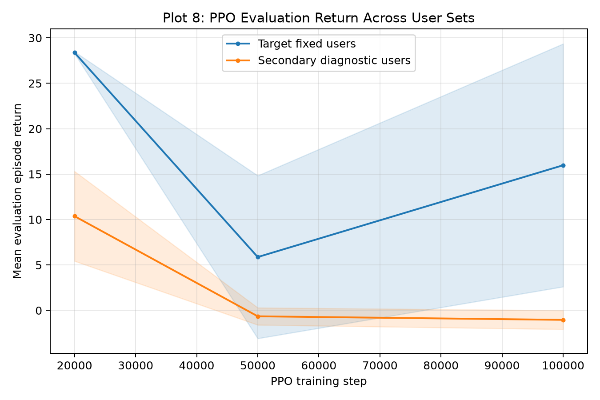
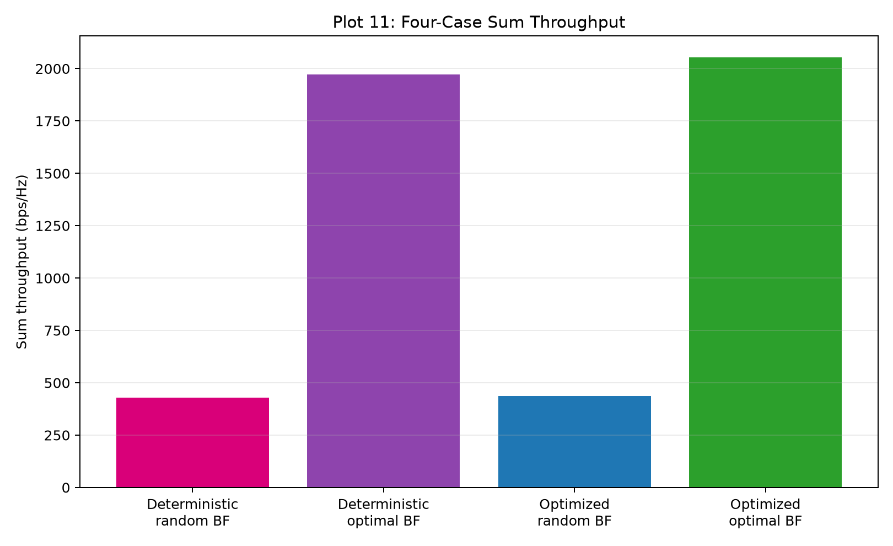
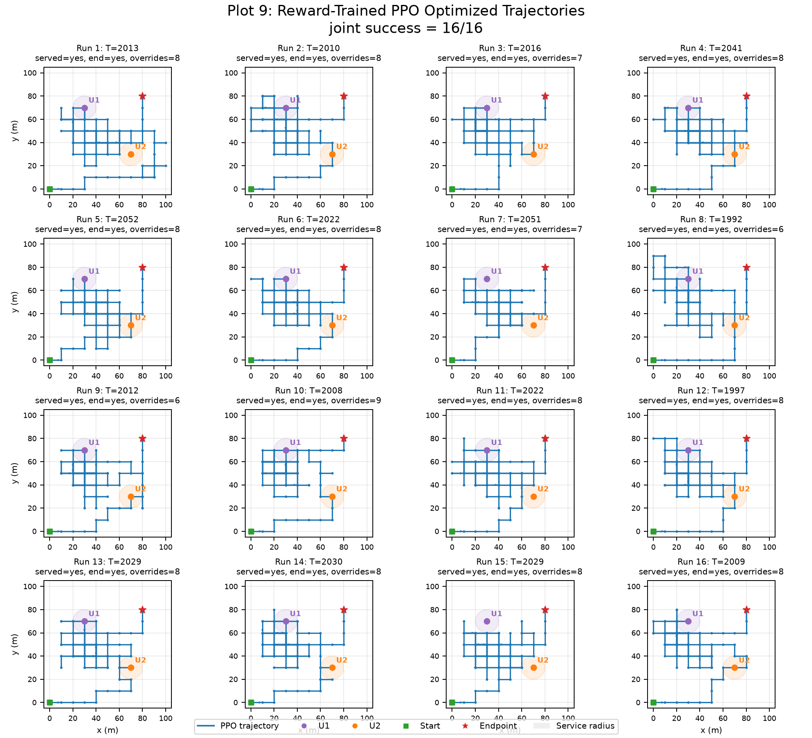

# UAV 辅助通信的轨迹与波束优化

UAV 作为空中基站，为两个地面用户提供下行通信。用 PPO 控制飞行轨迹，用 MRT 加功率网格搜索设计波束，目标是在飞完全程的同时，提高 200 秒内的累计和速率。

## 主要结论

- **波束优化的增益最大：** 同一条确定轨迹上，优化波束把累计和速率从 429.68 提升到 1971.26，约 4.6 倍。
- **PPO 轨迹的增益较小：** 16 次评估的均值为 2020.85，比确定轨迹高约 2.5%；其中最好的一次比确定轨迹高约 4.1%。
- **任务完成率：** 在固定用户布局和终点可达约束下，16 次评估全部完成双用户服务并到达终点。
- **策略还不稳定：** 最终模型来自第 20,000 步的检查点，后面的检查点吞吐更高，但成功率下降，详见[模型选择](#模型选择)。

## 系统模型

| 参数 | 取值 |
|---|---|
| 飞行区域 / 高度 | 100 m × 100 m / 50 m |
| 起点 → 终点 | (0, 0) → (80, 80) |
| 用户数 | 2 |
| 天线 | 8 元均匀线阵，半波长间距 |
| 载频 / 路径损耗指数 | 2.4 GHz / 2.5（LoS） |
| 总发射功率 / 噪声功率 | 0.5 W / −100 dB |
| 回合长度 | 200 步，每步 1 秒，移动 10 m |

每一步的 SINR 包含另一用户的干扰，速率按 `log2(1 + SINR)` 计算。

## 方法

**波束设计：** 每个用户用 MRT 确定波束方向，再用网格搜索在两个用户之间分配功率，取瞬时和速率最大的方案。

**PPO 环境：**
- **观测（11 维）：** UAV 位置、到终点的偏移、两个用户的信道增益及其变化、服务进度、剩余时间。观测中不包含用户坐标。
- **动作（5 个）：** 上、下、左、右、悬停。
- **奖励：** 吞吐量奖励、用户服务奖励、信道增益变化奖励、越界惩罚，以及回合结束时的漏服务和未到终点惩罚。
- **终点可达约束：** 如果某个动作会导致来不及到达终点，环境会把它替换成可行动作。

**训练：** 使用 Stable-Baselines3 的 PPO（两层 128 单元 MLP，学习率 3×10⁻⁴，折扣因子 0.995），共 100,000 步，分三个阶段：

| 阶段 | 步数范围 | 任务 |
|---|---|---|
| 服务发现 | 0 – 20,000 | 只要求服务用户，每人 1 秒 |
| 服务与到达 | 20,000 – 50,000 | 服务用户并到达终点，每人 1 秒 |
| 正式任务 | 50,000 – 100,000 | 服务用户并到达终点，每人 3 秒 |

## 模型选择

虽然训练跑满了 100,000 步，**最终使用的是第 20,000 步的检查点**。程序按“联合成功次数 → 服务成功次数 → 到达次数 → 吞吐量”的顺序选模型。下表是每个检查点在正式任务上 16 次验证的结果：

| 训练步数 | 双用户服务成功率 | 到达终点成功率 | 联合成功率 | 平均累计和速率 | 是否选中 |
|---:|---:|---:|---:|---:|---|
| 20,000 | 100% | 100% | 100% | 2028.25 | 是 |
| 50,000 | 12.5% | 100% | 12.5% | 2147.81 | |
| 100,000 | 50% | 100% | 50% | 2127.69 | |

继续训练后吞吐量提高了约 5%–6%，但经常漏服务用户，说明吞吐量和服务要求之间存在取舍，而且策略没有稳定收敛。



## 测试结果

选模型用的验证种子和最终评估用的 16 个种子互不重复，但用户布局相同，都是 (30, 70) 和 (70, 30)。评估时按策略概率采样动作。

| 方案 | 累计和速率（200 步求和，bit/s/Hz） |
|---|---:|
| 确定轨迹 + 随机波束 | 429.68 |
| 确定轨迹 + 优化波束 | 1971.26 |
| PPO 轨迹 + 随机波束 | 435.65 |
| PPO 轨迹 + 优化波束 | 2052.82 |
| PPO 轨迹 + 优化波束，16 次均值（范围 1992.31 – 2052.45） | 2020.85 |

表中第 3、4 行用的是 16 次评估里吞吐最高的那条轨迹，所以 4.1% 是最好情况，2.5% 才是平均水平。





## 已知局限

- **没有泛化：** 训练和最终评估用的是同一组用户位置。换一组位置后，第 20,000 步检查点的验证回报从 28.37 降到 10.37。
- **到达终点依赖约束：** 选中的检查点没有经过到达终点的训练阶段，每回合约有 6–9 个动作被约束替换，所以 100% 到达不能算作 PPO 自身的能力。
- **检查点太少：** 只比较了 3 个检查点，也只用了一个训练种子，不能说明最佳训练时长。
- **模型简化：** 只考虑 LoS 信道、两个用户和固定高度，波束也只用 MRT，没有主动抑制用户间干扰。

## 文件说明

```text
wireless_model.py    信道、MRT 波束、SINR 和功率分配
uav_environment.py   Gymnasium 环境：观测、动作、奖励和终点约束
train_model.py       分阶段 PPO 训练、检查点选择和策略评估
main.py              程序入口：评估、对比和全部图表
models/              选中的检查点和训练历史
results/             11 张图和完整结果摘要
tests/               77 项单元测试
```

## 运行方法

```bash
pip install -r requirements.txt
```

用仓库里的模型重新生成结果，不重新训练：

```bash
python main.py --skip-training --train-steps 100000 --model-path models/ppo_model --output-dir results
```

重新训练 100,000 步：

```bash
python main.py --train-steps 100000 --model-path models/ppo_retrained --output-dir results-retrained
```

运行测试：

```bash
python -m pytest tests -q
```

测试环境：Python 3.14.5、NumPy 2.5.2、Gymnasium 1.3.0、Stable-Baselines3 2.9.0、PyTorch 2.13.0（CPU）。在这个环境下，用仓库里的模型能复现上面的全部数字。
